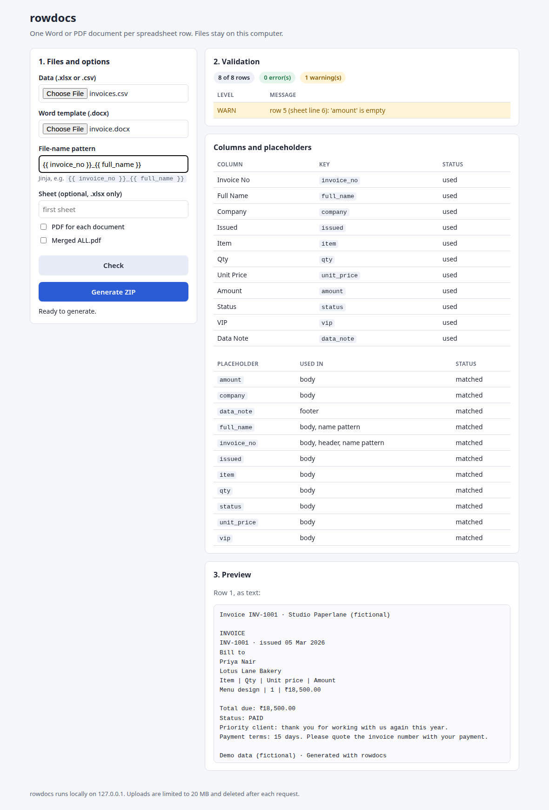

# rowdocs

**One Word or PDF document per spreadsheet row, checked before anything is generated.**
Give rowdocs a spreadsheet (`.xlsx` or `.csv`) and a Word template with `{{ placeholders }}`. It makes one
letter, certificate, invoice or contract per row, in `.docx` and optionally PDF. Before it writes anything, it
checks that every placeholder has a matching column, warns about empty cells and duplicate file names, and shows
you which column maps to which placeholder. Use it from the command line or from a small local web page. It
makes no network calls and has no telemetry, so your data stays on your computer.



*The web page after uploading `examples/invoices.csv` and `examples/invoice.docx`. Demo data (fictional).*

## Install

You need Python 3.11 or newer. PDF output also needs [LibreOffice](https://www.libreoffice.org/download/)
(optional; see [PDF output](#pdf-output)).

```bash
git clone <this repo> rowdocs && cd rowdocs
python -m venv .venv
source .venv/bin/activate          # Windows: .venv\Scripts\activate
pip install -e ".[dev]"            # the [dev] extra adds pytest and ruff
rowdocs --help
```

## Quick start

The `examples/` folder contains ready-made samples (**Demo data (fictional)**):

| File | What it is |
|---|---|
| `certificates.xlsx` + `certificate.docx` | 12 course certificates. Landscape layout, Excel dates, an `` for "with Distinction", and placeholders in the header and footer. |
| `invoices.csv` + `invoice.docx` | 8 invoices. A table, the `money` filter and an `` block. Row 5 has no amount, so you can see a warning. |

```bash
# 1. Check first: nothing is written
rowdocs check examples/invoices.csv examples/invoice.docx
#   WARN   row 5   row 5 (sheet line 6): 'amount' is empty
#   Result: 0 error(s), 1 warning(s)          -> exit code 0

# 2. Generate: one .docx per row, plus manifest.csv
rowdocs build examples/certificates.xlsx examples/certificate.docx -o out --name "{{ full_name }}"

# 3. PDFs, a merged ALL.pdf and a ZIP of everything
rowdocs build examples/certificates.xlsx examples/certificate.docx -o out --pdf --merge-pdf --zip

# 4. Only some rows
rowdocs build examples/invoices.csv examples/invoice.docx -o paid --where "status=paid" \
    --name "{{ invoice_no }}_{{ full_name }}"
rowdocs build examples/certificates.xlsx examples/certificate.docx -o few --rows 2-4,9

# 5. The web page (http://127.0.0.1:8765)
rowdocs serve
```

To regenerate the sample files, run `python examples/make_examples.py`.

## Commands

### `rowdocs check DATA TEMPLATE`

Validates the data against the template without generating anything.

| Level | Meaning |
|---|---|
| **ERROR** | A template variable has no matching column, the template has a syntax error or unknown filter, or the `--name` pattern is invalid. |
| WARN | A column is never used. |
| WARN | A used variable is empty in a row. The warning names the row and its line in the sheet. |
| WARN | Two or more rows would get the same file name. |

It also prints the header → key mapping and lists every template variable, with where it's used (body, header,
footer, name pattern).

| Option | |
|---|---|
| `--json` | Print a machine-readable report instead of the table. |
| `--strict` | Treat warnings as errors too. |
| `--name`, `--rows`, `--where`, `--sheet` | Same as `build`, so the check covers exactly what `build` will do. |

**Exit codes:** `0` means no errors. `2` means errors were found (or warnings, with `--strict`).

### `rowdocs build DATA TEMPLATE -o OUTDIR`

| Option | |
|---|---|
| `--name "{{ invoice_no }}_{{ full_name }}"` | The file-name pattern. It's Jinja, so filters work too. The default is `row_{{ _row }}`. |
| `--rows 2-10,15` | Only these data rows. Row 1 is the first row under the header. |
| `--where "status=paid"` | Only rows where a column equals a value (case-insensitive). `!=` also works. Repeat the option to combine filters (AND). |
| `--sheet NAME` | Which `.xlsx` worksheet to read. The default is the first sheet. |
| `--pdf` | Also convert every document to PDF, batched into one LibreOffice call per 200 files. |
| `--merge-pdf` | Also write `ALL.pdf`, with every PDF in row order. Implies `--pdf`. |
| `--zip` | Also write `OUTDIR.zip`, containing every output plus `manifest.csv`. |
| `--force` | Generate even when validation finds errors. Missing values render as empty. |

**How `build` behaves:**

- It runs `check` first and aborts with exit code 2, writing nothing, if `check` finds an error.
- `manifest.csv` is always written. Its columns are `row, output_docx, output_pdf, status, message`, and `status`
  is `ok`, `skipped` (not selected) or `error`.
- If a row fails, for example because a filter got bad input, the other rows are still generated. The error is
  recorded in the manifest and the exit code is `1`.
- File names are made safe:
  - path separators and characters that aren't allowed on Windows are replaced;
  - leading dots are removed, so `../` can't escape the output folder;
  - names are capped at 120 characters.
- Duplicate names get `_2`, `_3`… suffixes. They're compared case-insensitively, so the output is safe on Windows
  and macOS too.

**Exit codes:**

| Code | Meaning |
|---|---|
| `0` | OK |
| `1` | Some rows failed |
| `2` | Validation errors or bad input |
| `3` | `--pdf` was used but LibreOffice wasn't found. The `.docx` files are still written. |

### `rowdocs serve [--port 8765]`

Starts the local web page. It listens on **127.0.0.1 only** and rejects requests that use any other `Host` header.
The page:

1. Uploads the data file and the template.
2. Shows the validation result, with errors in red and warnings in amber, plus the column ↔ placeholder mapping.
3. Previews row 1 as text.
4. Lets you set the naming pattern and choose PDF or merged-PDF output.
5. Downloads a ZIP when you click **Generate**.

Only `.xlsx`, `.csv` and `.docx` files are accepted, up to 20 MB per request. Each request uses its own temporary
folder, which is deleted before the response is sent. The page is plain HTML, CSS and JavaScript, with no CDN.

## Template syntax cheat sheet

Write placeholders straight into Word: in the body, in tables, and in headers and footers. Column headers become
keys: they're trimmed and lower-cased, and spaces and punctuation become `_`. So **"Full Name"** becomes
`full_name`, and **"Unit Price (₹)"** becomes `unit_price`. `rowdocs check` shows the exact mapping.

| You want | Write in Word |
|---|---|
| A value | `{{ full_name }}` |
| The data row number | `{{ _row }}` |
| A value or a fallback | `{{ phone|default('n/a', true) }}` (`true` also replaces empty cells) |
| Upper case / Title Case | `{{ status|upper }}` · `{{ city|title }}` |
| A formatted date | `{{ issued|date('%d %b %Y') }}` → `05 Mar 2026` |
| Money | `{{ amount|money('₹') }}` → `₹1,234,567.50` |
| A condition inside a paragraph | `Priority client` |
| A comparison | `…` |
| Numbers stored as text in a CSV | `…` |
| Show or hide a whole paragraph | `` … ``, each on its own paragraph |
| Repeat a table row | `` … `` (from [docxtpl](https://docxtpl.readthedocs.io/)) |

**Values from each file type:**

- **CSV:** cells are read as text, so leading zeros in IDs are kept. `TRUE` and `FALSE` become booleans.
- **Excel:** numbers, dates and booleans keep their types.
- **Both:** an empty cell is false in an `` and renders as nothing.

## Filters

| Filter | Example | Result | Notes |
|---|---|---|---|
| `date(fmt)` | `{{ issued|date('%d %b %Y') }}` | `05 Mar 2026` | Accepts an Excel date cell, an Excel serial number, or an ISO string such as `2026-03-05`. Uses [`strftime` codes](https://docs.python.org/3/library/datetime.html#strftime-and-strptime-format-codes). An empty value renders as empty. |
| `money(symbol, decimals=2)` | `{{ amount|money('₹') }}` | `₹1,234,567.50` | Adds thousands separators and rounds half-up. Also reads `"1,200"` and `"₹1,200"`. An empty value renders as empty. Text that isn't a number makes that row fail, and the reason goes in the manifest. |
| `upper`, `lower`, `title` | `{{ name|upper }}` | `ASHA VERMA` | Built into Jinja. |
| `default(value)` | `{{ note|default('-') }}` | `-` | Built into Jinja. Add `, true` to also replace empty strings. |

All other [built-in Jinja filters](https://jinja.palletsprojects.com/en/stable/templates/#list-of-builtin-filters)
work too: `round`, `int`, `replace`, `trim` and so on.

## PDF output

rowdocs converts files with LibreOffice in headless mode (`soffice --headless --convert-to pdf`). It finds
`soffice` or `libreoffice` on your `PATH`, or in the standard install locations on macOS and Windows. Set
`ROWDOCS_SOFFICE=/path/to/soffice` to choose a specific binary.

| System | Install |
|---|---|
| Ubuntu / Debian | `sudo apt install libreoffice-writer` (or `libreoffice-writer-nogui` on servers) |
| macOS | `brew install --cask libreoffice` |
| Windows | Use the installer from libreoffice.org |

If LibreOffice is missing, `--pdf` still writes the `.docx` files and the manifest. It then prints these
instructions and exits with code 3.

## FAQ

**Why are my placeholders not replaced?**
Usually Word has split the placeholder into several "runs". This happens when you type part of it, edit it later,
change formatting halfway through, or when spell-check marks it. rowdocs (through docxtpl) repairs most splits.
If a placeholder still shows up unchanged, or `check` reports a syntax error:

1. Select the whole placeholder, delete it, and **retype it in one go** in the same formatting. Don't paste it in
   pieces.
2. Make sure Word hasn't replaced the quotes inside filters (`money('₹')`) with curly “smart quotes”. rowdocs fixes
   these in most cases, but retyping is the reliable fix.
3. Run `rowdocs check`. A placeholder whose name doesn't match a column key is reported as an **ERROR**, and the
   mapping table shows the expected key.

**My column is called "E-mail Address". What's the key?** `e_mail_address`. Run `rowdocs check` to see every
mapping.

**Can I use `.doc` or Google Docs templates?** Save them as `.docx` first. Legacy `.doc` isn't supported.

**Do my files leave my computer?** No. rowdocs makes no network calls. The web page only listens on 127.0.0.1, and
it deletes uploads after each request.

**Which rows are "row 1, row 2…"?** Data rows, not counting the header. Messages also show the sheet line, so
`row 5 (sheet line 6)` is line 6 in Excel.

## Development

```bash
pip install -e ".[dev]"
pytest          # 38 tests; the PDF test skips itself when LibreOffice Writer is not available
ruff check .
```

The tests are mapped to the acceptance criteria in [`SPEC.md`](SPEC.md) and need no network access.

Project layout:

```
rowdocs/
  data.py       load .xlsx/.csv, normalise headers, --rows / --where
  template.py   placeholder discovery (body, tables, headers, footers), rendering, text preview
  filters.py    date() and money()
  validate.py   rowdocs check
  naming.py     safe, unique output file names
  build.py      rowdocs build (manifest, PDF, merge, ZIP)
  pdf.py        LibreOffice detection and conversion, pypdf merge
  web.py        rowdocs serve (Flask) + static/index.html
```

## Credits and licence

- Author: **Harsha Shinde**.
- Licence: [MIT](LICENSE).
- Built on [docxtpl](https://github.com/elapouya/python-docx-template), [openpyxl](https://openpyxl.readthedocs.io/),
  [pypdf](https://pypdf.readthedocs.io/) and [Flask](https://flask.palletsprojects.com/).

**AI-assisted development:** the code, tests and documentation were written with an AI coding assistant (Claude)
and checked by the automated test suite.

**Demo data (fictional):** every name, company, course and amount in `examples/` and in the screenshot is
invented.
